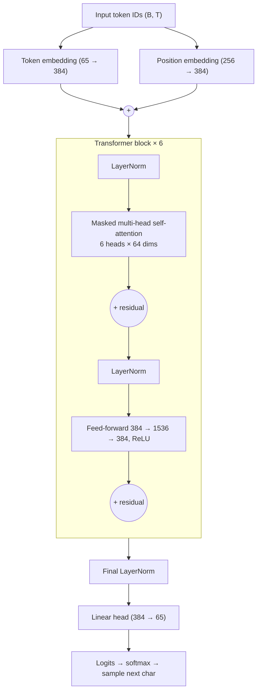

# GPT from Scratch

A ~10.8M-parameter, character-level GPT (decoder-only Transformer) implemented from first principles in PyTorch and trained on Tiny Shakespeare to generate Shakespeare-style text.

Based on Andrej Karpathy's ["Let's build GPT: from scratch, in code, spelled out"](https://youtu.be/kCc8FmEb1nY).

## Results

<!-- TODO: replace with numbers from your own training run -->

| Model | Parameters | Train loss | Val loss |
| --- | --- | --- | --- |
| Bigram baseline (`bigram.py`) | TODO | TODO | TODO |
| GPT (`gpt.py`) | ~10.8M | TODO | TODO |

Hardware: TODO (e.g. GPU model and training time)

Sample output from `gpt.py`:

```text
TODO: paste ~10 lines of generated text
```

## Architecture



## Key concepts implemented

- **Scaled dot-product self-attention**: query/key/value projections, with scores scaled by `1/sqrt(head_size)` to keep softmax well-conditioned.
- **Causal masking**: a lower-triangular mask so each position only attends to earlier positions, enabling autoregressive generation.
- **Multi-head attention**: 6 parallel heads concatenated and projected back to the embedding dimension.
- **Pre-LayerNorm residual blocks**: LayerNorm before attention and feed-forward sublayers, with residual connections around each.
- **Learned positional embeddings**: added to token embeddings since attention itself is permutation-invariant.
- **Regularization and initialization**: dropout on attention weights and sublayer outputs, and normal(0, 0.02) weight initialization.
- **Autoregressive sampling**: multinomial sampling from the softmax distribution, cropping context to `block_size`.

## Files

- [bigram.py](bigram.py): a minimal bigram language model baseline. Each character directly looks up the logits for the next character in an embedding table, with no attention.
- [gpt.py](gpt.py): the full Transformer model and training loop.
- [gpt_from_scratch.ipynb](gpt_from_scratch.ipynb): a notebook version of the step-by-step walkthrough.

## Setup

Requires Python 3 and PyTorch. Install dependencies with:

```bash
pip install -r requirements.txt
```

For GPU builds of PyTorch, follow the instructions at https://pytorch.org.

The scripts read `input.txt` from the working directory. Download the Tiny Shakespeare dataset with:

```bash
wget https://raw.githubusercontent.com/karpathy/char-rnn/master/data/tinyshakespeare/input.txt
```

## Usage

Run the bigram baseline:

```bash
python bigram.py
```

Run the full GPT model:

```bash
python gpt.py
```

Both scripts train the model, print train and validation loss at intervals, and then print 500 characters of generated text. The scripts use CUDA when it is available and fall back to CPU otherwise. Training `gpt.py` on CPU is slow.

## Model and hyperparameters

`gpt.py` uses the following settings:

| Hyperparameter | Value |
| --- | --- |
| Context length (`block_size`) | 256 |
| Batch size | 64 |
| Embedding dimension (`n_embd`) | 384 |
| Attention heads (`n_head`) | 6 |
| Transformer layers (`n_layer`) | 6 |
| Dropout | 0.2 |
| Learning rate | 3e-4 (AdamW) |
| Training iterations | 5000 |

With the 65-character Tiny Shakespeare vocabulary, this configuration has about 10.8M parameters.

The data is split 90/10 into train and validation sets. Tokenization is character-level, so each unique character maps to one integer.

## Next steps

- [ ] Byte-pair encoding (BPE) tokenizer instead of character-level tokens
- [ ] KV cache for faster generation
- [ ] Fused attention with `F.scaled_dot_product_attention`
- [ ] Mixed-precision training and model checkpointing
- [ ] Temperature and top-k sampling
- [ ] Ablations: effect of residuals, LayerNorm, head count, and depth on validation loss
